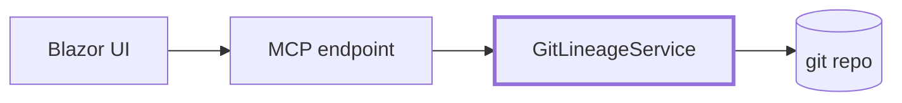
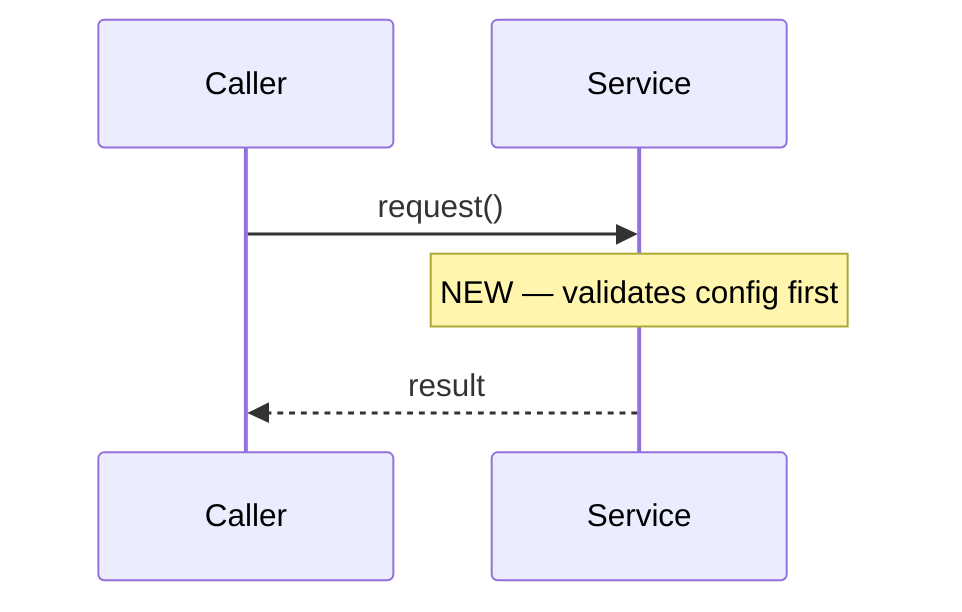
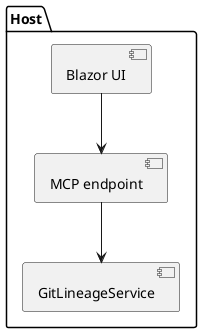

# Deck authoring reference

This skill adopts the Marp authoring conventions of the open-source
[softaworks/agent-toolkit `marp-slide` skill](https://github.com/softaworks/agent-toolkit/tree/main/skills/marp-slide)
(MIT): one idea per slide, front-matter-driven themes, headline-first slide
titles, and diagram-over-prose whenever structure can be drawn. If that
skill is installed, defer to its themes and `scripts/inspect-deck.mjs` for
layout QA; otherwise follow the rules below.

## Narrative ladder (mandatory ordering)

| Level | Slides | Voice |
|---|---|---|
| 1 — Intent | Title, "story at a glance" | Product/architecture language, zero file paths |
| 2 — Shape | Churn pie, commit timeline, architecture diagram | Areas, flows, components |
| 3 — Design | Per-area slides | Design decisions, trade-offs, named files |
| 4 — Detail | Flags, new files, appendix | Line-level specifics, review pointers |

Never let a lower level appear before a higher one. A reader must be able
to stop after any slide and still have a correct (if less detailed) model.

## Slide style

- ≤ 5 bullets per slide, ≤ 12 words per bullet.
- Every `<!-- ai-fill -->` marker must be replaced; delete the marker.
- Prefer a diagram to a bullet list when describing structure or flow.
- Use Marp directives sparingly — `<!-- _class: lead -->` for section
  dividers, `paginate: true` globally (the scaffold sets this).

## Extra Mermaid patterns

**Component-impact flowchart** (level 2) — show which components the change
touches and how they relate:

Bold-stroke the changed nodes. Derive nodes from the analysis `areas`.

**Before/after sequence** (level 3) — when behavior changed:

**State diagram** for lifecycle/status changes; **classDiagram** only when
the change is type-model-heavy.

## PlantUML variant

When the user or config requests PlantUML, emit fenced `plantuml` blocks
with the same ladder discipline:

Marp does not render PlantUML natively; for PDF export, pre-render with
`npx @plantuml/cli` (or a local `plantuml.jar`) to SVG and link the images,
mirroring what `deck.py export` does for Mermaid.

## PDF export notes

- `deck.py export` handles Mermaid pre-rendering automatically.
- Keep diagrams ≤ 12 nodes or they become unreadable at slide size.
- `pie` and `gitGraph` render wide — avoid putting prose on those slides.
- If a diagram fails to render, simplify it rather than switching to raster
  screenshots; plain-text diagram source is a hard requirement of this skill.
