<!-- slide: opening -->
<!-- _class: title -->
# A useful draft. A smaller first release.

**Release-note review, before automatic publishing.**

A visual PRD and level-zero design. Fictional example. Decisions remain open.

Golden example - adapt the method, not the domain rules

---

<!-- slide: decision-outcome -->
<!-- _class: decision -->
## What should the first release earn?

<h3>A. Reviewable draft</h3>
One selected release, a sourced draft, and a visible result.
Recommended pilot

<h3>B. Scheduled digest</h3>
Repeated summaries across sources. Adds timing and identity rules.

<h3>C. Publishing service</h3>
Approved content reaches channels. Adds external-effect recovery.

Choose the outcome before the orchestration. A postpones scheduling and publication; it does not prove they are unnecessary.

D1 UNACCEPTED - recommendation only - brief R1/R2

---

<!-- slide: prd -->
## The product is a result the owner can verify

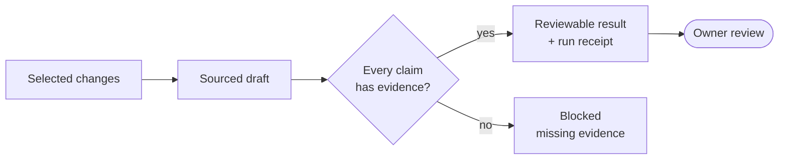

Success is a useful draft with traceable claims, not merely a completed model call.

Proposed PRD - brief R1/R3 - source identity and limits unresolved

---

<!-- slide: scope -->
## Remove breadth, not the evidence boundary

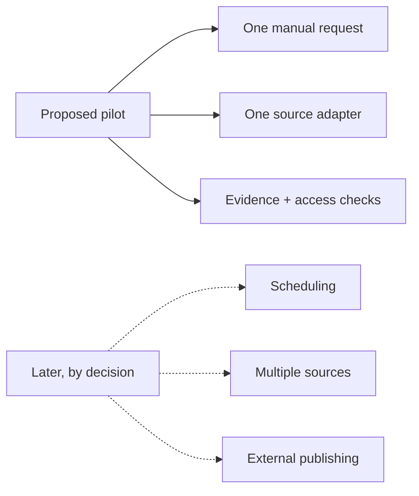

Solid = proposed first release. Dashed = deferred, not deleted from the reference.

D1 unaccepted - brief R2/R3 - no existing policy is amended by this diagram

---

<!-- slide: context -->
## Level zero: keep ownership visible

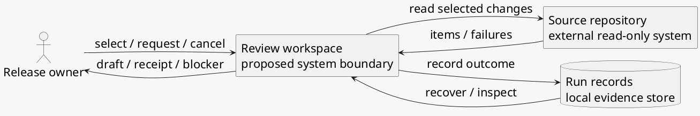

L0 proposal, not implementation - brief R1/R3/R4 - no publishing edge

---

<!-- slide: services-stores -->
## Modules do not need to become microservices

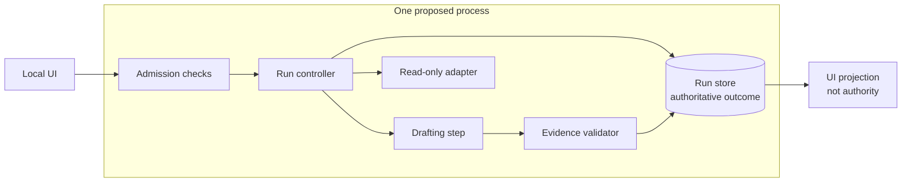

Add deployment boundaries only when scale or isolation earns their operational cost.

Proposed placement - brief R1/R3 - store durability and access contract still to decide

---

<!-- slide: owner-usecases -->
## The owner gets control as well as output

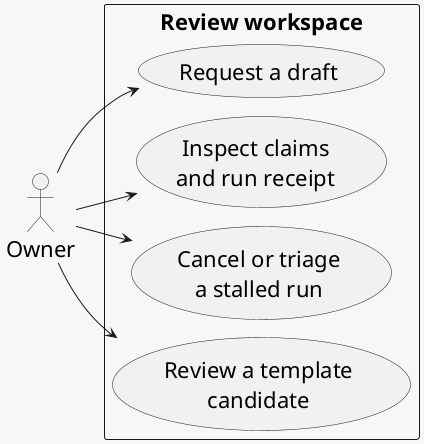

Primary outcome + secondary control paths - brief R1/R4/R6

---

<!-- slide: team -->
## Each role has a responsibility, not implied authority

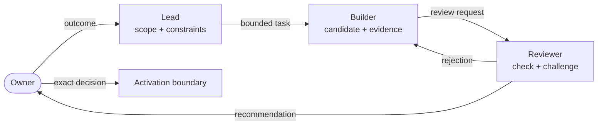

Collectively: propose, implement, challenge, decide. A review recommendation is not an activation command.

Illustrative roles - brief R5 - use real charters and per-member diagrams when the target needs more detail

---

<!-- slide: lifecycle -->
## A timeout is uncertainty, not success

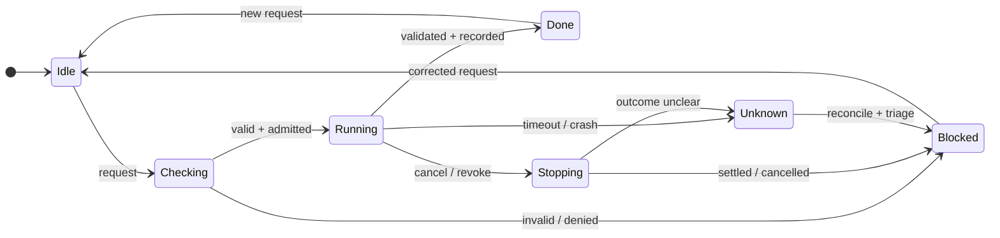

Reject a second request while active. Restart reconstructs from records; unknown work is never retried blindly.

Proposed transition contract - brief R4 - detailed triggers in appendix

---

<!-- slide: gates -->
## Exact rules stay outside the drafting step

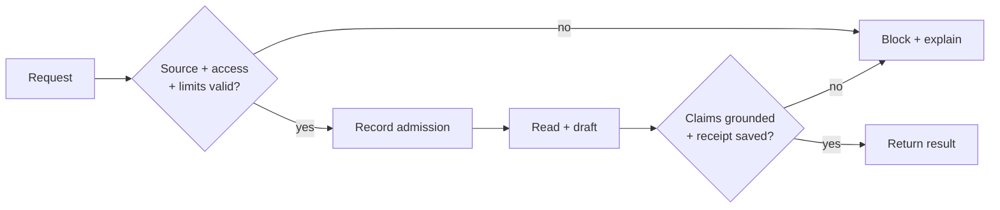

A model may propose wording. It does not decide access, numeric limits or whether missing evidence is acceptable.

Brief R3/R7 - recording failure prevents the next step; admission failure performs no source read

---

<!-- slide: human-seams -->
## Every handoff returns an observable answer

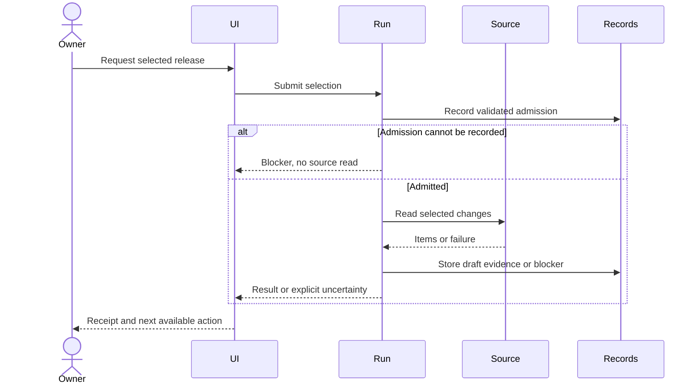

Operation seam - brief R1/R3/R4 - no hidden publication or human approval inferred

---

<!-- slide: change-at-rest -->
## Change the next run, not the one already admitted

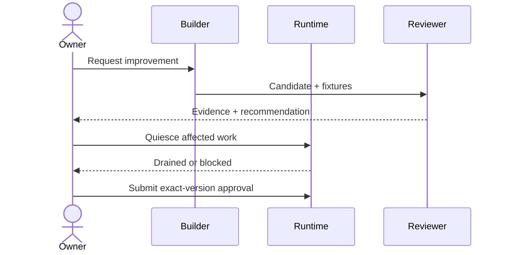

Urgent restrictions apply immediately. Routine template changes wait for a known boundary.

D2 UNACCEPTED - illustrative at-rest policy - brief R6

---

<!-- slide: activation -->
## Approval is input; current checks decide activation

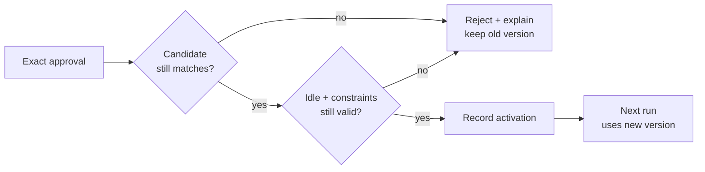

An old approval cannot activate new bytes. A record failure leaves activation blocked, not partially successful.

D2 unaccepted - brief R6 - complements the human handshake rather than hiding gates in a long sequence

---

<!-- slide: recovery -->
## Recovery starts with evidence, not repetition

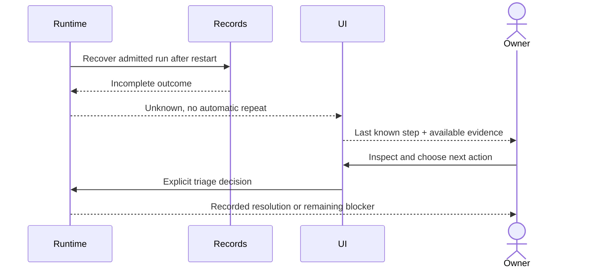

Incident seam - brief R4 - a new request is distinct from claiming the old one completed

---

<!-- slide: policy -->
## Data policy is a release prerequisite

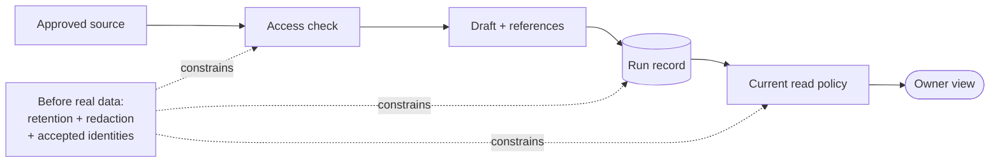

Do not inherit privacy rules from a sample. Resolve the real project's obligations before admitting real data.

Open release gate - brief R3/R7 - dashed edges denote requirements awaiting decisions

---

<!-- slide: delivery -->
## Build the smallest complete evidence loop

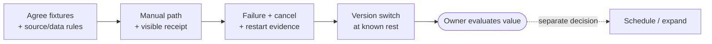

No invented dates. Each step exits on observable evidence; later breadth needs a new value decision.

Delivery recommendation only - brief R1-R7 - all product functionality remains unbuilt

---

<!-- slide: trigger-catalog -->
<!-- _class: appendix -->
## Check the less visible edges

| Trigger | Guard / next state | Observable output |
| --- | --- | --- |
| Invalid source, denied access, limit reached | Checking to Blocked | Reason, no read |
| Record write fails | No next step; reconcile admitted work | Error / unknown, never success |
| Cancel or revoke | Running to Stopping | Admission closed, settle or unknown |
| Timeout, crash, restart | Unsettled run to Unknown | Last evidence, no blind repeat |
| Candidate changes after approval | Reject activation | Old version remains |
| Corrected request / new run | Only after known settlement | New identity and admission |

Brief R3/R4/R6/R7 - expiry, schedule and external callbacks are outside this pilot, not assumed implemented

---

<!-- slide: decisions-evidence -->
<!-- _class: appendix -->
## Keep decisions separate from rendering evidence

| Item | Status | What settles it |
| --- | --- | --- |
| D1: manual draft first | Unaccepted recommendation | Owner chooses outcome |
| D2: exact version at rest | Unaccepted recommendation | Owner accepts change policy |
| Source, limits, data policy | Open release prerequisites | Explicit contract + fixtures |
| Product behavior | Unbuilt | Implementation and behavioral evidence |
| Presentation | Locally testable | Build + Playwright + visual inspection |

Source coverage: brief R1-R7. This fictional deck demonstrates a method; it is not permission to build or publish.

Rendering tests prove the artifact, never the product

