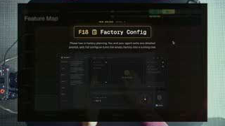

# ZERO to RUNNING Software Factory In 16 Minutes (LIQUID Software)

- **Creator:** IndyDevDan
- **Source:** https://www.youtube.com/watch?v=GRlcm3wmOqs
- **Published:** 2026-11-09 14:00:16 UTC
- **Duration:** 16:35 (995 seconds)
- **Selection:** position 1 in the channel's newest-first uploads snapshot on 2026-11-10.

## Original summary

This second lesson presents a small software factory as a reusable application that is deliberately easy to reshape. Dan's central argument is about changing the engineer's relationship to work: instead of continuously prompting an agent, configure a system that prepares results and calls for attention when a decision is needed. He distinguishes this human-near-the-loop approach from both interactive assistance and fully unattended operation. “Liquid software” describes the intended adaptability of the application, not a demonstrated guarantee of autonomous correctness.

The practical workflow separates initialization, configuration and specialization. Initialization copies the empty factory into another application's workspace while leaving the original template available for reuse. Configuration uses a substantial written plan to adapt that copy to a particular problem. In this example, the target is product analytics for an image-generation application. An interactive coding agent performs the configuration while Dan demonstrates capabilities already available in the empty template. The lesson therefore alternates between building a specialized instance and exploring its reusable starting point.

One addition is a tool-summary layer: a lightweight model condenses tool activity into readable descriptions, with adjustable grouping and visible length. Underlying calls remain inspectable. This is a proposal for reducing monitoring effort, not evidence that a generated summary is an authoritative execution record. Another addition is specialized, single-task subagent delegation. The demonstration gives workers different responsibilities for examining the server, client and skill, then combines their findings into a page. Model choice, tools, system instructions, time limits and spending limits are presented as configurable controls, with run histories available for inspection.

A recurring design principle is that the agent can manipulate the same application controls as the user. Dan illustrates this through changes to summaries, subagent defaults, themes, navigation information and settings views. These examples make the customization argument tangible, although they do not establish permission separation or production safety. Near the end he reports that the analytics configuration has completed, then argues for focused systems rather than one general-purpose agent handling every recurring problem. The public lesson does not provide a sustained evaluation of that configured analytics application; its clearest evidence is the initialization and template-capability walkthrough.

## Timestamped topics

- [00:28 — Interaction model](https://www.youtube.com/watch?v=GRlcm3wmOqs&t=28s): in-loop, near-loop and out-of-loop work are distinguished; this series targets the middle position.
- [01:36 — Adaptable software](https://www.youtube.com/watch?v=GRlcm3wmOqs&t=96s): why a factory should keep changing with the problem it serves.
- [04:17 — Initialize](https://www.youtube.com/watch?v=GRlcm3wmOqs&t=257s): mount a reusable empty factory beside an existing or new application.
- [06:23 — Configure](https://www.youtube.com/watch?v=GRlcm3wmOqs&t=383s): use a written plan to turn that instance toward product analytics.
- [08:12 — Tool summaries](https://www.youtube.com/watch?v=GRlcm3wmOqs&t=492s): lightweight summarization, grouping and access to underlying calls.
- [10:02 — Specialized subagents](https://www.youtube.com/watch?v=GRlcm3wmOqs&t=602s): bounded workers inspect separate parts of the application and synthesize a page.
- [12:31 — Agent access parity](https://www.youtube.com/watch?v=GRlcm3wmOqs&t=751s): the agent changes its application settings and interface through tools.
- [15:12 — Specialization over a universal agent](https://www.youtube.com/watch?v=GRlcm3wmOqs&t=912s): closing argument and preview of small agent teams.

## Illustrative frames

These are **actual public storyboard video samples**, not cover thumbnails. Each is only **320 × 180**; approximate times below are inferred from yt-dlp's storyboard frame rate, not frame-accurate seeks. Use the topic links above for precise discussion starts.

### Approximately 04:16 — Feature map

The feature-map heading is visible near the initialization discussion. It illustrates the lesson's incremental presentation of factory capabilities rather than a completed analytics product. Small labels are not reliably readable at this resolution.

### Approximately 06:24 — Configuration feature

The configuration feature card accompanies the planning stage: a generic template needs a problem-specific plan before it becomes useful. The heading, rather than fine diagram detail, is the reliable visual evidence here.

### Approximately 10:01 — Specialized subagents

The specialized-subagents heading marks the transition to bounded delegation. The surrounding discussion supplies the important design choices—separate tasks, model selection and budgets—which should not be inferred from unreadable small text in this sample.

## Evidence and limitations

- Exact public metadata was obtained using yt-dlp with `--ignore-config --skip-download --dump-single-json`; the UTC publication time comes from its Unix `timestamp`, not the research-folder date.
- English automatic `en-orig` JSON3 captions were successfully fetched and parsed in memory across the video, suppressing repeated adjacent segments. No manual captions or chapters were advertised. Automatic speech recognition may misrender names and technical terms; these notes avoid relying on uncertain spellings.
- Direct 720p extraction returned HTTP 403, including a bounded attempt with the public format's User-Agent. Public storyboard sheets were accessible; only the three cropped samples above are retained. Approximate times use frame index divided by the reported storyboard rate; allow roughly 15 seconds of sampling/alignment uncertainty.
- The image viewer returned success without usable image pixels in this agent context. Actual PNG content was checked using local macOS Vision OCR and image decoding; recognized headings support the captions above, but this is **OCR-based inspection, not a complete visual review**. No credential-label warning was detected; low resolution limits that check.
- This packet contains original research commentary and three illustrative stills. Copyright remains with the respective rightsholders. Full transcripts, subtitle files, audio/video downloads, copied descriptions and signed media URLs are not included. Claims about durability, cost limits and autonomy are the presenter's claims, not independently tested properties.
