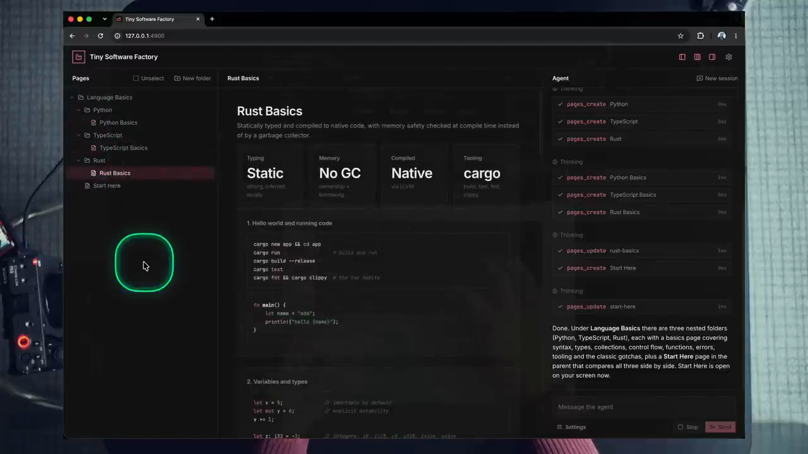
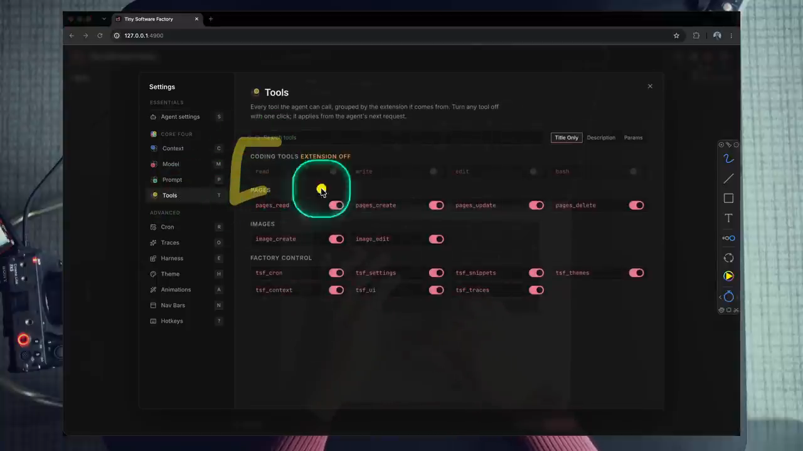
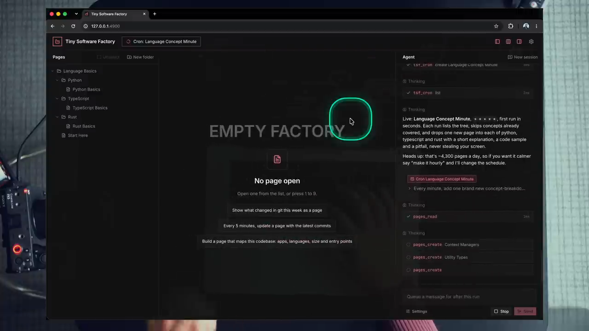

# Tiny Software Factories: Agentic Engineering DONE WRONG

- **Creator:** IndyDevDan
- **Source:** https://www.youtube.com/watch?v=1v7ldJiyH-Y
- **Published:** 2026-11-02 14:00:24 UTC
- **Duration:** 18:36 (1116 seconds)
- **Selection:** position 2 in the channel's newest-first uploads snapshot on 2026-11-10.

## Original summary

The first lesson deliberately frames tiny software factories as a shortcut, not a scalable end-state architecture. Dan warns that the series trades technical completeness and long-term design quality for quickly obtaining useful results. That warning is essential to interpreting the demonstrations: the goal is to move a person from repeatedly prompting an agent toward reviewing work that an agent has already prepared, not to prove that a small application is ready for unrestricted autonomous operation.

His proposed unit is a factory dedicated to one recurring problem, containing a persistent agent and a trigger in an execution environment. He distinguishes an empty factory—a reusable application with general capabilities but no assigned purpose—from a running instance adapted to a concrete job. The claimed advantage is that engineers can repeatedly initialize, configure and specialize this starting point rather than build every surrounding interface from scratch. Human feedback is presented as a way to improve results, although no measured learning experiment is supplied.

The initial walkthrough uses a three-part interface: a list of artifacts on the left, the selected artifact in the center and an agent on the right. The agent creates introductory programming-language pages as disposable example work. A broader principle then connects the interface to agent tools: controls available to a human should have corresponding operations the agent can invoke. Dan demonstrates adjusting agent settings and disabling coding tools. He explicitly acknowledges that such self-modification can be dangerous without appropriate control.

The lesson groups agent configuration into context, model, prompt and tools. It shows context-compaction settings, model tiers, inspectable prompts and tool definitions, then describes the harness as composable capability layers. Additional examples change themes and navigation elements through the agent. These are demonstrations of configurability rather than independent evidence for isolation or safe privilege changes.

Finally, scheduled prompts turn the interactive example into recurring work. A cron job asks the agent to add concepts to the language pages; the agent raises concerns before the presenter confirms how to proceed. The example then produces additional page content and another scheduled event. Dan claims the backend continues working without the browser open. The accessible upload ends just as the narration transitions to another feature, so it should not be summarized as a complete demonstration of a specialized running factory or a long-duration reliability test.

## Timestamped topics

- [00:38 — Deliberate shortcuts](https://www.youtube.com/watch?v=1v7ldJiyH-Y&t=38s): the presenter warns that the approach includes anti-patterns and is not a long-term architecture recommendation.
- [02:12 — What a tiny factory is](https://www.youtube.com/watch?v=1v7ldJiyH-Y&t=132s): one recurring problem, proactive work and human review near the loop.
- [06:25 — Empty factory and interface](https://www.youtube.com/watch?v=1v7ldJiyH-Y&t=385s): a reusable template, then lists, selected content and an agent panel.
- [09:16 — Agent access parity](https://www.youtube.com/watch?v=1v7ldJiyH-Y&t=556s): user-interface operations have corresponding agent tools.
- [09:56 — Four configuration dimensions](https://www.youtube.com/watch?v=1v7ldJiyH-Y&t=596s): context, model, prompt and tools; later examples change settings and remove coding capabilities.
- [12:49 — Extensible harness](https://www.youtube.com/watch?v=1v7ldJiyH-Y&t=769s): capability layers rather than one undifferentiated agent interface.
- [13:55 — Interface customization](https://www.youtube.com/watch?v=1v7ldJiyH-Y&t=835s): themes, navigation, status displays and hotkeys.
- [16:10 — Scheduled prompts](https://www.youtube.com/watch?v=1v7ldJiyH-Y&t=970s): a recurring page-writing example, initial objections and subsequent scheduled activity.

## Illustrative frames

Three **1280 × 720 frames** were extracted by seeking directly into the public video stream. Timestamps are requested seek positions, rounded to a video frame by the decoder.

### 09:00 — Generated pages in the factory

The actual frame contains the factory's pages interface and Python, TypeScript and Rust labels. This anchors the discussion of an editable artifact list and selected content; these teaching pages are example data, not the factory's final specialized purpose.

### 12:11 — Tool configuration

The tools/settings view appears during the explanation of disabling coding capabilities. It illustrates the important distinction between giving an agent a conversation panel and exposing configurable capabilities through the application. The narrated safety warning belongs with this example.

### 17:23 — Recurring page work

The frame contains the cron context and programming-language page labels during the recurring update demonstration. It is relevant to the transition from manual prompting to scheduled work; a single still cannot prove continued operation while the browser is closed.

## Evidence and limitations

- Exact public metadata was obtained using yt-dlp with `--ignore-config --skip-download --dump-single-json`; the UTC publication time comes from its Unix `timestamp`.
- English automatic `en-orig` JSON3 captions were successfully fetched and analyzed in memory across the video, suppressing repeated adjacent segments. No manual captions were advertised. Automatic captions sometimes render technical language or schedule wording inconsistently; notes describe recurring work without treating every utterance as a definitive configuration value.
- Direct extraction initially returned HTTP 403. Supplying the public format's User-Agent allowed bounded, input-seek ffmpeg extraction from format 136. No authenticated cookies, credentials or access-control bypass were used. Earlier storyboard candidates were discarded; only the three final direct frames are retained.
- The image viewer returned success without usable image pixels in this agent context. Actual PNG content was inspected using local macOS Vision OCR and image decoding. Recognized interface labels support the captions, but this is **OCR-based inspection, not a complete visual review**. No credential-label warning was detected; that check cannot certify the absence of every sensitive detail.
- The available caption track ends mid-transition near the end of this 18:36 upload. No subsequent course content is assumed. Durability, scaling benefits and safety controls were not independently tested.
- This packet contains original research commentary and three illustrative stills. Copyright remains with the respective rightsholders. Full transcripts, subtitle files, audio/video downloads, copied descriptions and signed media URLs are not included.
