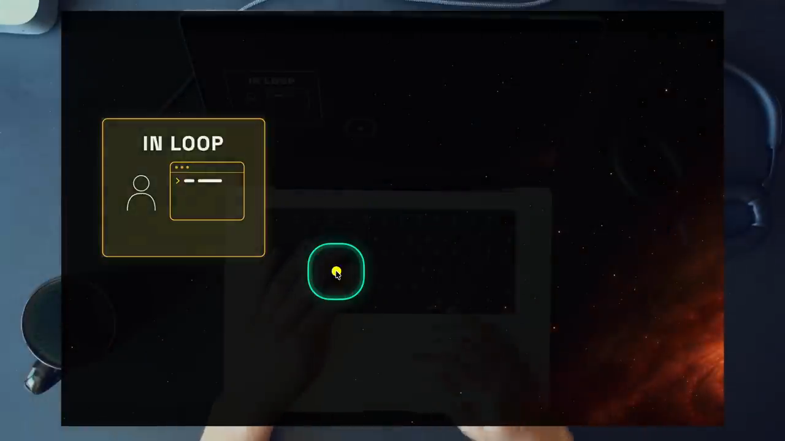
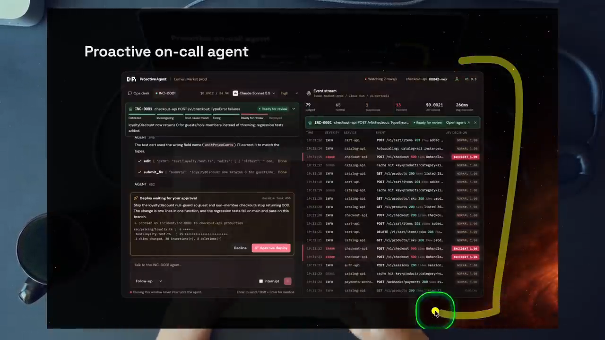
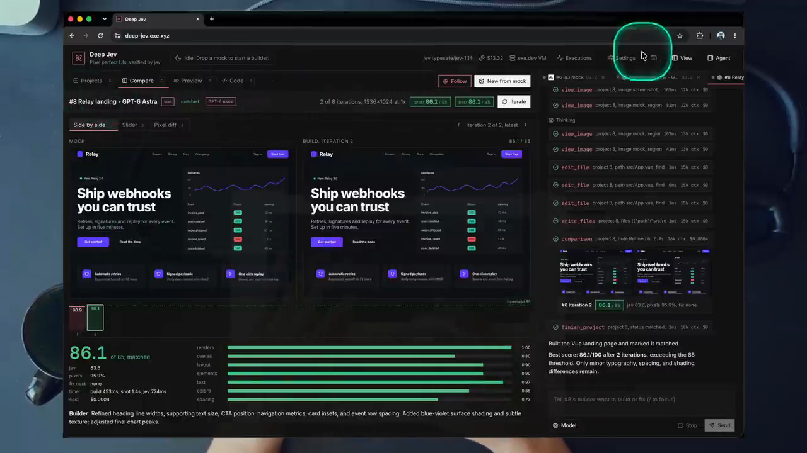

# ELITE Agentic Engineers Are LEAVING THE LOOP... Here’s why

- **Creator:** IndyDevDan
- **Source:** https://www.youtube.com/watch?v=52JX83rGPLc
- **Published:** 2026-10-26 13:00:05 UTC
- **Duration:** 25:46 (1,546 seconds)
- **Selection:** third upload in the supplied newest-first channel snapshot; researched 2026-11-10.

## Original summary

Dan argues that engineering leverage increasingly comes from designing useful work that proceeds without continuous prompting. He separates three operating modes: a person actively directing an agent, a person returning for specific decisions, and a system operating on scheduled or event-driven triggers. The middle mode matters because moving directly from interactive assistance to unattended execution is difficult. His illustrative workflow prepares an incident fix before asking for approval, then continues with application, verification, and result recording after the decision.

The proposed architecture combines persistent agent state, an isolated execution environment, and an API that accepts triggers. Cron, incoming events, tickets, and other interfaces can initiate work; a human need not initiate every session. Browser and terminal interfaces become clients of the longer-lived system rather than the place where its existence depends on an open window. Persistence is presented as essential for interrupted work and delayed human responses. These are architectural claims and demonstrations, not a crash-recovery test report.

Three examples make the argument concrete. An incident-response demonstration classifies incoming events, investigates a checkout failure, and presents a patch awaiting deployment approval. A running news-curation interface filters information and incorporates votes into future ranking. A UI-replication tool repeatedly builds, captures a screenshot, and compares it with a supplied design. The latter exposes iteration history and a similarity target; Dan also describes an attempt that stopped improving, so the example should not be read as guaranteed convergence. The incident interface is explicitly introduced as a mock example, while the news and UI tools are presented as systems he is using.

His skills argument is broader than choosing a stronger model. Context, model cost/performance, instructions, and available tools must be designed together, supported by ordinary software-engineering judgment. He specifically raises reducing dangerous capabilities, including removing general shell access when narrower actions suffice. The proposed success measure is useful work accomplished independently, not indiscriminate token consumption. The closing section promotes his forthcoming advanced engineering product. Claims that agents outperform people or can autonomously handle most work are the presenter's position, not findings established by this packet.

## Timestamped topic guide

- [02:14 — Three operating modes](https://www.youtube.com/watch?v=52JX83rGPLc&t=134s): prompting continuously, returning for decisions, and scheduled operation.
- [05:31 — Approval in the middle of a workflow](https://www.youtube.com/watch?v=52JX83rGPLc&t=331s): preparation before the human decision and execution/verification afterward.
- [06:11 — Architecture prerequisites](https://www.youtube.com/watch?v=52JX83rGPLc&t=371s): durable state, isolated compute, an API, and nonhuman triggers.
- [08:42 — Incident-response example](https://www.youtube.com/watch?v=52JX83rGPLc&t=522s): investigation and a proposed fix; the displayed incident is a mock demonstration.
- [10:04 — News-curation example](https://www.youtube.com/watch?v=52JX83rGPLc&t=604s): filtering and user feedback as a continuing product interaction.
- [12:00 — Iterative UI replication](https://www.youtube.com/watch?v=52JX83rGPLc&t=720s): build/screenshot/compare cycles with a similarity threshold.
- [15:38 — Engineering skills beneath autonomy](https://www.youtube.com/watch?v=52JX83rGPLc&t=938s): context, model economics, prompts, and specialized tools.
- [19:17 — Capability restriction and useful work](https://www.youtube.com/watch?v=52JX83rGPLc&t=1157s): narrower tools, avoiding reckless command execution, and measuring outcomes rather than activity; product promotion follows later.

## Illustrative frames

### 1. The interactive starting point — [02:30](https://www.youtube.com/watch?v=52JX83rGPLc&t=150s)

The opening stage of the operating-mode illustration anchors the contrast with later approval-driven and scheduled systems. It accompanies the explanation of attention spent continually prompting; it is not a complete architecture specification.

### 2. Incident review instead of continuous prompting — [09:22](https://www.youtube.com/watch?v=52JX83rGPLc&t=562s)

The mock incident dashboard places an event stream beside an agent's proposed checkout fix and a deployment-approval state. This makes the human decision point concrete: preparation has happened, but deployment is still awaiting a decision.

### 3. A measurable UI-refinement loop — [13:25](https://www.youtube.com/watch?v=52JX83rGPLc&t=805s)

The replication dashboard juxtaposes the requested design and generated page with iteration results. It illustrates a bounded comparison objective rather than an open-ended conversation; a displayed similarity score is not independent proof of visual or functional correctness.

## Evidence, limitations, and rights

Public per-video metadata and the English `en-orig` automatic caption track were fetched successfully. Captions across the full duration informed the notes; recognition errors, especially product/model names, remain possible. The precise publication time is YouTube's timestamp as exposed by yt-dlp, not an independently verified upload event.

The three retained PNGs are 1280×720 frames extracted using bounded remote seeks in the public H.264 stream. Initial extraction failed; a public metadata-provided User-Agent enabled these captures. A later alternative-frame request received HTTP 403 and was not pursued. No complete video/audio file was retained. PNGs were decoded and their content checked with local OCR against the caption context. **The image-view tool returned no visible pixel payload to this session, so this is OCR-assisted content inspection, not a completed full visual review.** Fine details and absence of sensitive text cannot be exhaustively certified by OCR.

This packet contains original commentary and three limited illustrative stills, attributed to the linked video. It does **not** provide a full transcript, subtitles, copied description, or audiovisual download. Copyright remains with the respective rights holders. This is source research, not authorization to adopt its architecture or change project policy.
