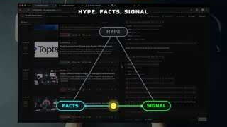
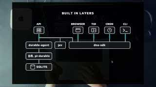
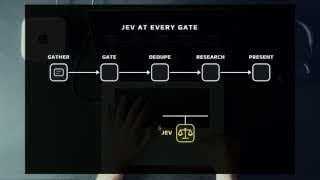

# My Jev Pi Durable Agent CURATES News: HYPE, FACT, or SIGNAL

- **Creator:** IndyDevDan
- **Source:** https://www.youtube.com/watch?v=OLqP8jxJ0Wc
- **Published:** 2026-10-19 13:00:05 UTC
- **Duration:** 22:34 (1,354 seconds)
- **Selection:** fourth upload in the supplied newest-first channel snapshot; researched 2026-11-10.

## Original summary

Dan demonstrates a personalized news agent that keeps gathering information while its user is absent. A browser dashboard and terminal interface connect to the same agent running on a separate machine. Refreshing a client does not recreate the underlying agent. He also shows a separately deployed instance with different preferences. The central design lesson is the separation of a persistent service from the interfaces used to inspect and direct it, with scheduled work supplying the initiative normally provided by a person typing prompts.

The news product distinguishes excitement-driven coverage, factual information, and information the particular reader can act on. These categories are not interchangeable: something can be true without being useful to the reader's immediate work, and a useful announcement can still contain promotional hype. Dan's examples reflect his own engineering interests. The system is therefore a personalized ranking product, not an objective or independently validated truth detector.

He describes a layered implementation: SQLite persistence, Pi Durable, a specialized agent, an API, and a shared SDK used by browser, terminal, command-line, and scheduled clients. A news sweep gathers material, filters it, removes duplicates, ranks candidates, and lets the agent decide what to present. Jev is positioned as a fast, inexpensive classifier ahead of more costly language-model processing. He explicitly recommends ordinary content hashing before semantic duplicate checks. Combining sources to assess a claim is discussed, but the video does not establish a rigorous fact-checking accuracy benchmark.

The hands-on portion demonstrates preference feedback through votes and weighted keywords. A request to increase interest in a model family changes a stored keyword weight, affecting later sweeps. Messages can queue while an existing sweep finishes. The agent's tools are specific to news work: gathering candidates, researching sources, classifying material, presenting cards or a timeline, and asking the user about taste. This is deliberately different from exposing a generic coding assistant as the product.

The broader recommendation is to engineer a service that prepares value before the user returns, then incorporates feedback and continues. The demonstration includes minute-based sweeps and a seven-card limit, but those are shown configuration choices rather than universal recommendations. Cost claims are qualitative, and persistence claims are not accompanied by failure-injection evidence. The ending includes promotion of an upcoming course, so its broader autonomy and productivity claims should be read in that context.

## Timestamped topic guide

- [01:34 — Detached clients and a persistent agent](https://www.youtube.com/watch?v=OLqP8jxJ0Wc&t=94s): synchronized browser/terminal access and scheduled activity.
- [03:45 — Filtering before expensive processing](https://www.youtube.com/watch?v=OLqP8jxJ0Wc&t=225s): the stated cost rationale for placing Jev earlier in the pipeline.
- [05:19 — Hype, fact, and actionable signal](https://www.youtube.com/watch?v=OLqP8jxJ0Wc&t=319s): why truth and personal usefulness are different judgments.
- [07:02 — Deployment and architecture](https://www.youtube.com/watch?v=OLqP8jxJ0Wc&t=422s): cron/API initiation, separate instances, and the layered stack at 08:30.
- [10:07 — The news-sweep workflow](https://www.youtube.com/watch?v=OLqP8jxJ0Wc&t=607s): gathering, filtering, deduplication, ranking, and presentation; hashing precedes semantic checks.
- [12:29 — Feedback and preference weighting](https://www.youtube.com/watch?v=OLqP8jxJ0Wc&t=749s): votes, queued instructions, and a demonstrated keyword-weight update.
- [15:46 — Task-specific agent tools](https://www.youtube.com/watch?v=OLqP8jxJ0Wc&t=946s): news research and presentation actions instead of a general coding interface.
- [18:30 — Traces, settings, and remaining tuning](https://www.youtube.com/watch?v=OLqP8jxJ0Wc&t=1110s): inspectable executions, deployment locations, acknowledged improvements, and later cost discussion/product promotion.

## Illustrative frames

These are **native 320×180 public storyboard tiles**, not full-resolution screenshots or thumbnails. Times are approximate, inferred from the storyboard sampling rate; they locate the surrounding discussion rather than an exact decoded video frame.

### 1. Different kinds of information — [approximately 05:26](https://www.youtube.com/watch?v=OLqP8jxJ0Wc&t=326s)

The concept slide frames the product's central distinction: excitement, truth, and usefulness are different dimensions. Its heading is confirmed by local OCR; the adjacent spoken explanation supplies the interpretation, not a transcription of tiny slide text.

### 2. Persistence beneath the clients — [approximately 08:53](https://www.youtube.com/watch?v=OLqP8jxJ0Wc&t=533s)

The layered-system diagram accompanies the explanation of storage, a durable agent, an API, and multiple clients. It is useful as a structural reference, but its small labels should be inspected in the linked original; this low-resolution tile cannot establish implementation details on its own.

### 3. Processing before presentation — [approximately 10:22](https://www.youtube.com/watch?v=OLqP8jxJ0Wc&t=622s)

The pipeline illustration accompanies the description of gathering, filtering, deduplicating, and ranking candidates. Its visible gathering label and flow structure connect the architecture to a concrete operation, rather than presenting the product as simply a chat interface.

## Evidence, limitations, and rights

Public metadata and the English `en-orig` automatic caption track were fetched successfully. Captions across the full duration informed the notes; transcription errors remain possible. The precise UTC publication time is the timestamp exposed by yt-dlp from YouTube metadata.

Direct H.264 frame requests failed, including with the public metadata-provided User-Agent; the latter returned HTTP 403. No access barrier was bypassed. The materially different fallback retrieved public storyboard images in memory and retained only three selected tiles. Approximate times are derived from tile indexes and yt-dlp's reported sampling rate; they are not frame-accurate. Native resolution is retained without implying recovered detail.

PNGs were decoded and checked with local OCR against timestamped captions; headings support relevance, but fine text is mostly unreadable. **The image-view tool returned no visible pixel payload to this session, so full visual review remains unverified.** These deliberately selected concept diagrams avoid credential/settings screens; OCR cannot exhaustively certify image contents. The video is a creator demonstration, not independently reproduced software or a reliability, factuality, or cost benchmark.

This packet contains original commentary and three limited illustrative stills attributed to the video. It does **not** provide a full transcript, subtitles, copied description, or audiovisual download. Copyright remains with the respective rights holders. Research does not authorize product adoption or policy changes.
