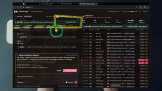
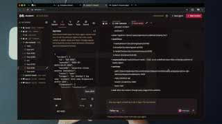
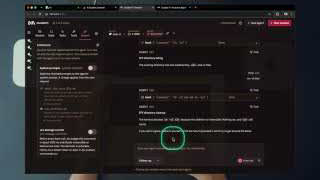

# Pi Durable PROACTIVE Agents: Jev Triggers My ON-CALL Pi Agent

- **Creator:** IndyDevDan · **Published:** 2026-10-12 13:00:15 UTC
- **Source:** https://www.youtube.com/watch?v=DNDYYHsypZg
- **Duration:** 35:16 (2,116 seconds) · **Selection:** fifth newest in the parent’s 2026-11-10 channel snapshot.

## Original summary

This demonstration treats an agent as a continuing service rather than a conversation tied to an open terminal. Pi Durable is presented as preserving conversations, work and application state while allowing people to reconnect through different clients. The important architectural shift is separating the agent’s execution from the interface used to supervise it.

The opening example is an on-call workflow. Jev classifies incoming application events and triggers an incident-response agent with the error and its context. The agent investigates, reads logs, examines earlier events and prepares a repair before requesting deployment approval. Dan initially declines, requests an explanation and code difference, then approves a checkout-related null-handling fix. **This is a mock product with simulated event traffic**, explicitly acknowledged later around 13:56; the demonstration is not evidence of a real production incident being autonomously resolved. The approval pause illustrates work happening before a human arrives, with review still possible afterward.

The network playground then demonstrates persistent JSON application state shared by agent sessions on the same device. That is a more specific claim than universal shared memory across every machine. Repeatable jobs add named phases, workspace snapshots, approval-dependent release checks, status inspection and cancellation. Together these features support long-running workflows that can stop at a decision point instead of occupying someone’s terminal continuously.

Customization is another recurring theme. Multiple clients can connect to a detached agent; tools and extensions can be changed while it runs; context can be forked to explore another direction. A Jev-based command-checking extension blocks a destructive command in the example, and Dan subsequently disables that protection. This demonstrates configurable behavior, not a verified security boundary or a recommendation to disable safeguards.

The broader argument is for owning the harness and designing proactive services with observable state, resumable steps and explicit review points. Persistence and controlled human intervention are the useful patterns; the video alone does not establish crash-consistency guarantees, exactly-once external effects or production readiness.

## Timestamped topics

- [01:47 — What durability means](https://www.youtube.com/watch?v=DNDYYHsypZg&t=107s): persistence across failure, beyond a terminal-bound chat.
- [02:10 — Event-triggered on-call workflow](https://www.youtube.com/watch?v=DNDYYHsypZg&t=130s): Jev-triggered investigation, proposed fix and human deployment review.
- [05:56 — Network playground](https://www.youtube.com/watch?v=DNDYYHsypZg&t=356s): device/session navigation and a reconnectable agent interface.
- [07:56 — Shared application state](https://www.youtube.com/watch?v=DNDYYHsypZg&t=476s): persistent JSON read and update operations across sessions on one device.
- [09:44 — Durable jobs](https://www.youtube.com/watch?v=DNDYYHsypZg&t=584s): phased work, snapshots, approval pauses, monitoring and cancellation. [13:56](https://www.youtube.com/watch?v=DNDYYHsypZg&t=836s) explicitly identifies the incident traffic as simulated.
- [14:22 — Detached execution and tools](https://www.youtube.com/watch?v=DNDYYHsypZg&t=862s): connecting clients to agents that continue independently of the interface.
- [20:23 — Live customization](https://www.youtube.com/watch?v=DNDYYHsypZg&t=1223s): extensions, a command-checking demonstration and session forks.
- [25:44 — Why build this way?](https://www.youtube.com/watch?v=DNDYYHsypZg&t=1544s): proactive work, multiple clients and less continuous human supervision; these are the presenter’s recommendations.

## Illustrative frames

These are actual **320 × 180 public storyboard stills**, not thumbnails or generated illustrations. Times are approximate, estimated from storyboard metadata, with roughly one 10-second sampling interval of uncertainty. Fine screen text is not reliably readable.

### Approximately 02:59 — Incident response

Source-aligned incident-response still. The surrounding demonstration follows detection through investigation to an approval gate in a mock checkout application; it is not proof of a production remediation.

### Approximately 08:56 — Shared state

Source-aligned shared-state still. The accompanying passage describes persistent, per-device JSON application state readable by another agent session, not unrestricted memory shared across every machine.

### Approximately 22:01 — Configurable extensions

Source-aligned extension-control still. The nearby passage contrasts a blocked destructive command with behavior after protection is disabled. This is a configuration demonstration, not a verified security boundary.

## Evidence and limitations

Public watch-page metadata and English `en-orig` automatic captions were fetched without authentication using yt-dlp with configuration disabled. Caption events were parsed in memory and overlapping repetitions removed. Minute samples spanning the video and focused incident, state/job and extension passages support this summary; later supplemental caption requests returned HTTP errors and were not retried. Automatic captions can confuse names, code and numbers.

Direct 720p range-seek extraction failed, including a targeted public request-header correction. The fallback fetched only public storyboard images, cropped in memory; no video/audio file was saved. The image viewer did not expose pixels to the analysis context. PNG decoding/CRC checks passed and local macOS Vision OCR was attempted; tiny text was unreadable in these stills, so frame captions explain their source-time passages rather than claim unverified screen details. No copied description, full transcript, subtitle file or signed media URL is included. Three stills accompany original research commentary; source copyright remains with its respective owners. This packet changes no repository runtime or policy.
