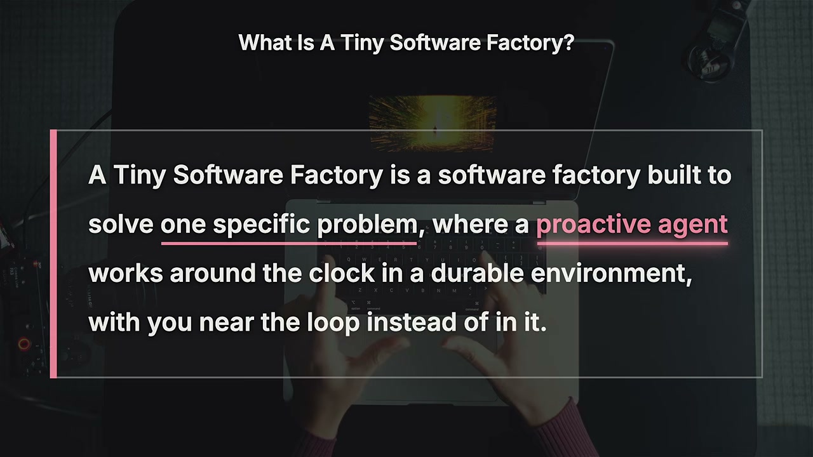
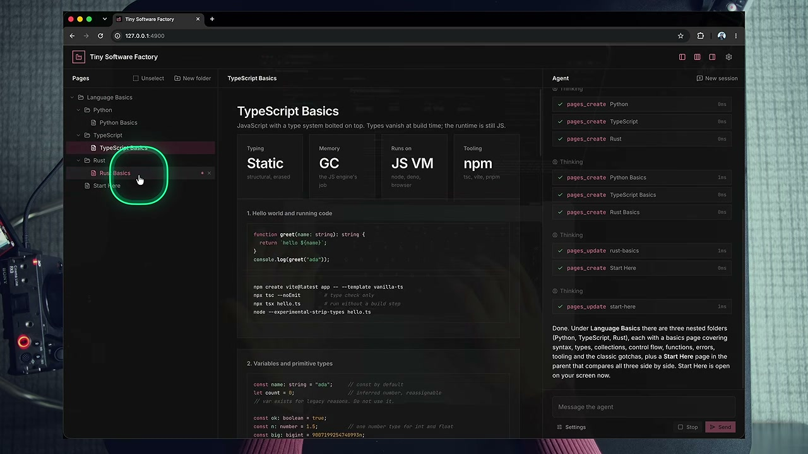
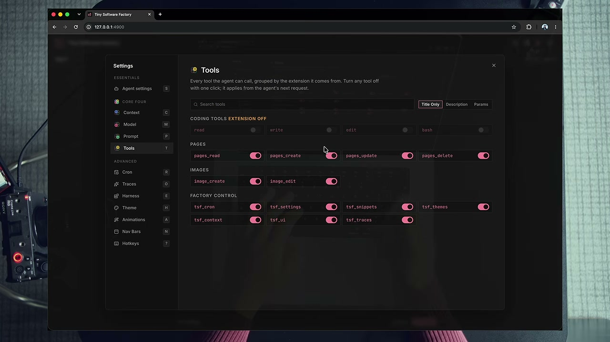
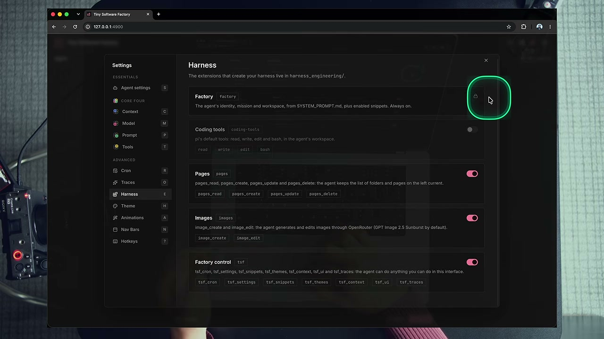
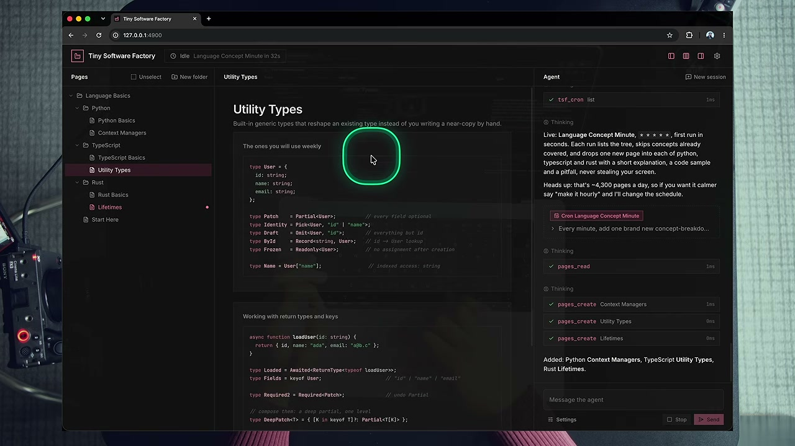

# Tiny Software Factories: Agentic Engineering DONE WRONG

- **Creator / source:** IndyDevDan — https://www.youtube.com/watch?v=1v7ldJiyH-Y
- **Published:** 2026-11-02 14:00:24 UTC, carried from the earlier public-metadata snapshot; not independently refreshed by this local-file run.
- **Measured media:** 1115.914 seconds (about 18:36), 1280 × 720, 30000/1001 fps.
- **Evidence:** new local Paldom execution, pinned at `576f5ea880f965091be26320065dd732ea483e50`; Whisper `small.en` ASR, scene timeline, and five newly refined source frames. The earlier notes are comparison material, not new-run evidence.

## Original summary

Dan introduces tiny software factories as a deliberately compromised route to useful automation. The opening warning matters: this is a compressed, shortcut-heavy approach, not a recommendation for long-term architecture or unrestricted autonomy. He contrasts repeatedly prompting an agent with remaining nearby to review its output, provide feedback and make decisions. Claims that feedback improves the factory and that much existing work can run without people are motivational assertions, not measured findings in this lesson.

The proposed unit tackles one recurring problem through an agent, a trigger and an environment intended to keep work running. A reusable “empty factory” supplies capabilities before acquiring a particular purpose. Dan emphasizes initialization, configuration and specialization rather than a single general system that solves every problem. A feature map organizes the walkthrough around incremental value and effort. The demonstration remains primarily an exploration of this reusable starting point, not an end-to-end evaluation of a specialized service.

The browser example connects an artifact list, a central working area and an agent panel. The presenter requests introductory Python, TypeScript and Rust pages; the resulting interface contains language folders and explanatory pages. This makes the relationship between conversation and editable artifacts concrete. The page examples are disposable demonstration content, however: their presence does not establish instructional accuracy, robust storage or safe handling of arbitrary application data.

A central idea is parity between interface controls and agent tools. Dan groups configuration into context, model, prompt and tools, showing compaction controls, model choices and inspectable prompts/tool descriptions. He then asks the agent to disable coding tools and change its thinking setting. A later tools screen explicitly labels the coding-tools extension as off. That supports the displayed configuration state, not an independently tested inability to execute code. The presenter acknowledges the danger of self-modification without appropriate controls; this warning should accompany any reuse of the pattern.

The harness is presented as layers of capabilities rather than one indivisible agent. A settings view lists factory identity, coding tools, pages, images and factory controls. Further examples use the agent to change themes and navigation/status elements. These illustrate accessible customization and composability, but do not demonstrate permission separation, rollback or containment of a mistaken configuration change.

Scheduled prompts supply the transition from interactive editing to recurring work. The agent initially objects to absent file-writing access and the volume of a frequent schedule; the presenter confirms using page tools instead. Later page labels and tool-result text show new language concepts alongside the cron context. Dan says the backend continues operating when the browser is closed. That remains a spoken claim, not a browser-closed reliability test. The narration then breaks off while introducing another feature, and the final ASR fragment adds no dependable conclusion. The defensible takeaway is a small, configurable demonstration of recurring artifact work—not proof of durable autonomous engineering.

## Five illustrative frames

All five JPEGs are **1280 × 720**, extracted with the unmodified pinned `frame-at` command. Times are requested source seeks, subject to decoder frame rounding. Captions below rely on **Tesseract OCR and source-time context, not a complete pixel-level visual review**.

### 1. [02:25 — The proposed unit](https://www.youtube.com/watch?v=1v7ldJiyH-Y&t=145s)

OCR recovers a complete definition centered on one problem, a proactive agent and near-loop involvement. The slide states the presenter's design intent; it does not demonstrate round-the-clock durability.

### 2. [08:58 — Generated artifacts](https://www.youtube.com/watch?v=1v7ldJiyH-Y&t=538s)

Recognized folder labels, the TypeScript Basics heading and page-tool activity connect the artifact demonstration to the narration. Small code text is imperfectly recognized and has not been validated or executed.

### 3. [12:15 — Coding tools disabled in settings](https://www.youtube.com/watch?v=1v7ldJiyH-Y&t=735s)

OCR identifies the tools panel and its coding-tools-off label while page and factory-control tools remain listed. This is evidence of a displayed setting, not enforcement or a safe self-modification boundary.

### 4. [13:13 — Capability layers](https://www.youtube.com/watch?v=1v7ldJiyH-Y&t=793s)

The Harness heading and factory, coding, pages, images and factory-control labels support the composability discussion. The pipeline assigns this and frame 3 to the same long interval despite their different contents: scene intervals are not semantic chapters.

### 5. [17:38 — Scheduled page work](https://www.youtube.com/watch?v=1v7ldJiyH-Y&t=1058s)

OCR identifies cron context plus Context Managers, Utility Types and Lifetimes pages and their creation activity. It also retains a high-volume warning. This moment links scheduling to example output without proving unattended continuity.

## Practical takeaways and adoption limits

- Reuse the narrow-problem, visible-artifact and bounded-schedule ideas; do not copy blanket agent/UI privilege parity as a safety policy. Demonstration configuration is not authorization evidence.
- The new run produced **38 ASR segments, median/max 30 seconds**. Technical names are distorted, schedule wording is inconsistent, and the last segment overruns measured media by **24.086 seconds**. Selected evidence ranges stay in bounds. Heuristic `pass` and 100% timed coverage establish neither accurate transcription nor fine alignment.
- The original timeline kept **32 candidates**, including one gap-fill sample and two intervals under two seconds. Several cut-start OCR results were overlays or noise. One bounded refinement pass produced these five substantially more readable moments. Speech association remains **temporal overlap**, not proof that each utterance describes the pictured control.
- A [separate one-minute timing experiment](../../timing-experiment.json), on the other processed video, yielded 23 shorter segments without `-nt` versus two with it, but still overshot the clip by 300 ms. It motivates validation, not a proven fix; this packet uses the unchanged main-run ASR.
- Relative to the earlier three-still packet, this adds two useful viewpoints and machine-checkable provenance, not certified visual accuracy. JPEGs decode successfully; OCR found no obvious credential-panel content, but cannot certify privacy or visual completeness. Pixel review and alignment checks remain gates before internal adoption.
- Across the six-video evaluation, **two were processed and four were blocked by HTTP 403** after ordinary 720p/format-18 attempts. This video's success does not imply all six worked. No runtime capability or internal adoption is established.

Only original commentary, five limited stills and text-free provenance are retained here; no full transcript, OCR dump, speech timeline or media. Rights remain with the respective rightsholders. See [evidence.json](evidence.json) for frame bounds, hashes and explicit uncertainty.
