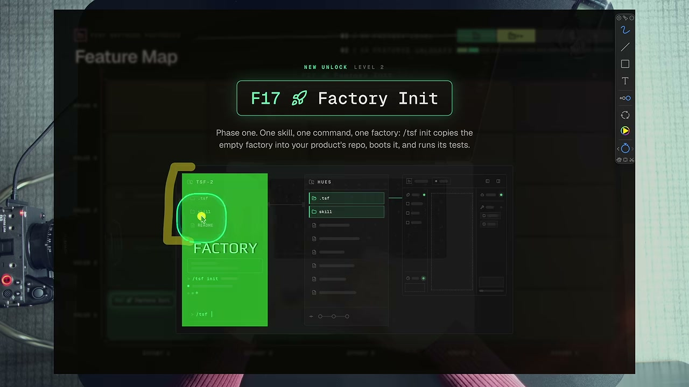
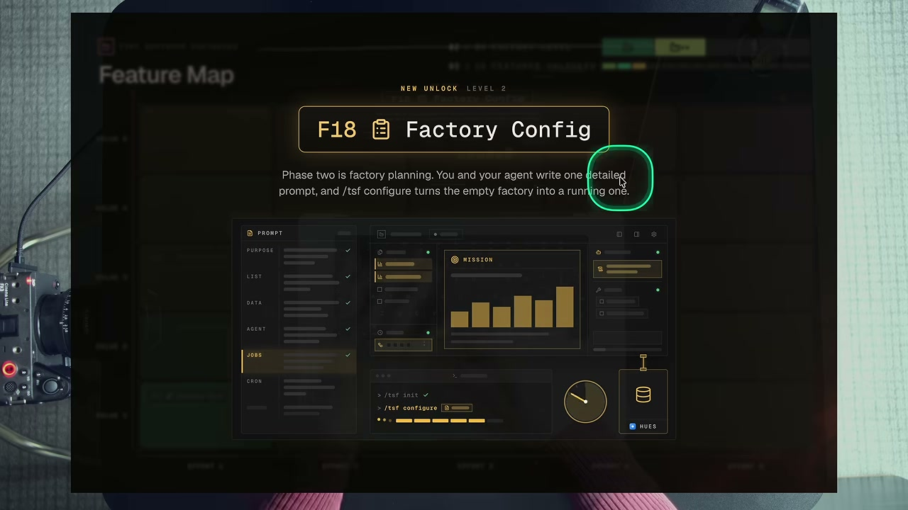
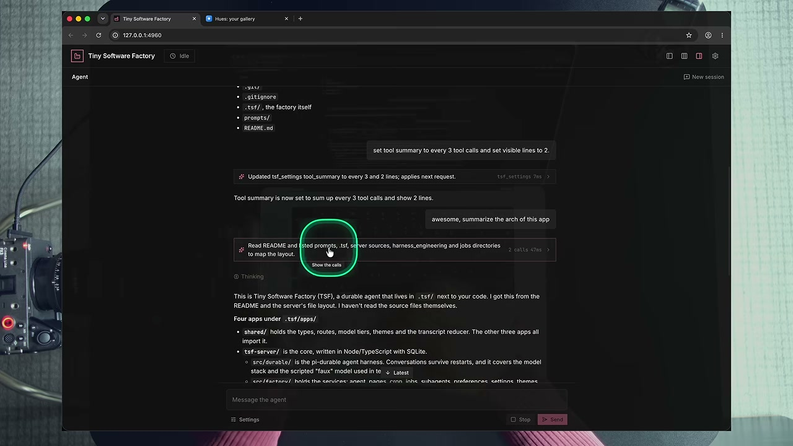
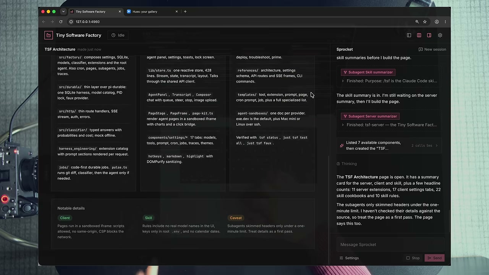
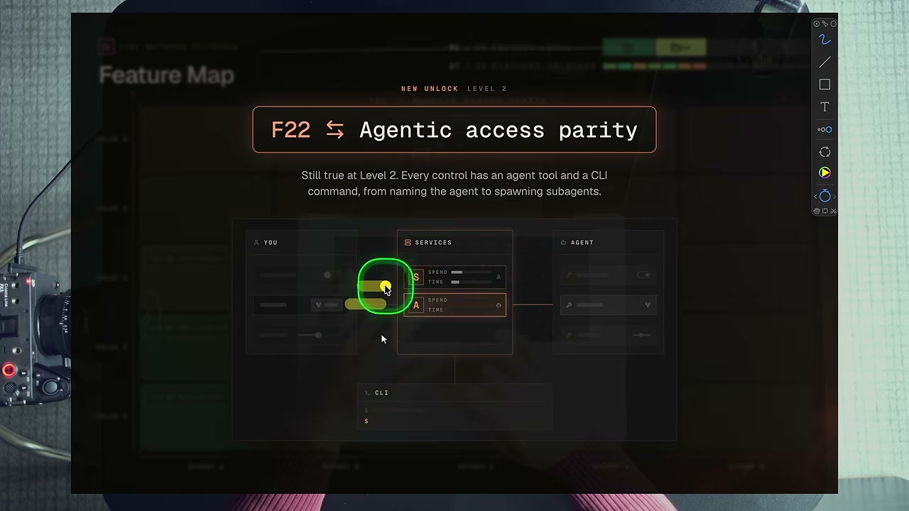

# ZERO to RUNNING Software Factory In 16 Minutes (LIQUID Software)

- **Creator/source:** IndyDevDan — [original video](https://www.youtube.com/watch?v=GRlcm3wmOqs).
- **Evaluation:** 2026-11-10 local Paldom run; video `GRlcm3wmOqs`; measured duration **994.714 seconds** (16:34.714), **1280 × 720**, approximately 29.97 fps.
- **New evidence:** locally executed Whisper `small.en` ASR and scene/OCR pipeline, followed by two bounded frame-refinement passes using the pinned upstream `frame-at` command. Pin: `576f5ea880f965091be26320065dd732ea483e50`.
- **Review boundary:** OCR and transcript/context interpretation only. Image viewing returned success without usable pixels; this is **not a completed visual review**. [Structured provenance](evidence.json) records exact requested seek times, candidate intervals and coarse transcript windows.

## Original summary

Dan’s second Tiny Software Factories lesson argues that the valuable change is not choosing another agent primitive but changing how an engineer participates in work. Interactive prompting keeps the person inside each cycle; a near-the-loop arrangement lets work proceed until a result or decision needs attention. Fully unattended operation is a separate ambition. The lesson targets the middle position and calls its adaptable application template “liquid software”: something deliberately built to change as the recurring problem becomes better understood.

The implementation story starts with an empty factory rather than a universally capable agent. Generic tooling becomes useful only after receiving a purpose. Dan describes initialization, configuration and specialization as distinct stages. Initialization copies the reusable template into an existing or new application’s workspace, leaving the source template unchanged. The example target is product analytics for an image-generation application. Configuration then uses a substantial jointly prepared written plan, rather than treating installation alone as a finished solution. An interactive coding agent works on that adaptation while the presentation returns to features already present in the generic template.

Tool summaries are one of those features. A lightweight model turns tool activity into short explanations, while underlying calls remain available for inspection. Dan changes grouping and visible length through the agent itself, then requests an architecture overview. This makes monitoring less demanding, but it does not turn a model-generated account into verified execution evidence. Importantly, OCR of the newly extracted interface frame supports a qualification absent from a headline-only reading: the displayed architecture explanation distinguishes information gathered from documentation and layout from source code it has not inspected.

Specialized delegation adds separate tasks, model choices, instructions, tools, execution time and spending settings. The demonstration assigns server, client and skill summaries to three workers, asks for a lightweight tier and short limits, and combines the results into an application page. The point is bounded, appropriately priced work rather than always using maximum capability. The new high-resolution result frame also contains an important caveat, supported by OCR: the workers skimmed headers under their time limit, and the combined page should be treated as an initial pass rather than source-checked analysis. Run histories and inspectable inputs and outputs are useful observability features; the video does not independently establish the strength of budget enforcement or the correctness of these summaries.

The final recurring idea is agent access parity: application controls should have corresponding agent operations. Dan illustrates changes to tool-summary settings, subagent defaults, themes, navigation information and keyboard-oriented interaction. This links customization to the broader near-the-loop argument, but convenience is not evidence of authorization isolation. Near the end he reports the analytics configuration complete and argues for focused systems serving repeated problems, not one agent doing everything. The retained lesson is therefore a reusable initialization-and-customization pattern with observable delegation—not a sustained evaluation of a production analytics service or a proof of safe autonomy.

## Five illustrative frames

All images are native **1280 × 720 JPEGs**, not upscaled storyboards. Times are exact inputs to the upstream extraction command, not word timestamps or independently measured decoded-frame presentation timestamps. Each refinement lies inside its recorded candidate interval; that interval is not proof of an unchanged scene or semantic alignment.

### 1. [04:30 — Initialization](https://www.youtube.com/watch?v=GRlcm3wmOqs&t=270s)

**OCR-supported observation:** an initialization feature heading and explanatory text are legible. **Interpretation:** copying a reusable factory beside a target application precedes problem-specific configuration; the slide’s operational claims are not test results. Selected 13.044 seconds after candidate 13’s start, replacing its earlier empty-template heading.

### 2. [06:40 — Configuration as planning](https://www.youtube.com/watch?v=GRlcm3wmOqs&t=400s)

**OCR-supported observation:** the configuration heading and planning description are recovered. **Interpretation:** a detailed plan connects the template to its intended workload. Selected 16.084 seconds after candidate 19’s start; its original still still named initialization. No small diagram geometry is claimed from OCR.

### 3. [09:45 — Readable activity with scope caveats](https://www.youtube.com/watch?v=GRlcm3wmOqs&t=585s)

**OCR-supported observation:** the interface conversation includes summary-grouping controls and an architecture response that limits its own inspection scope. **Interpretation:** concise monitoring should retain access to underlying evidence and qualifications. Selected 60.476 seconds after candidate 24’s start; that candidate is a gap-fill sample, not an independently established scene boundary.

### 4. [11:35 — Delegation results are explicitly preliminary](https://www.youtube.com/watch?v=GRlcm3wmOqs&t=695s)

**OCR-supported observation:** an architecture page, worker-result references and a qualification about header-level inspection appear in OCR. **Interpretation:** quick parallel summaries can aid orientation without amounting to code review. Selected 25.732 seconds after candidate 26’s start. A first-pass seek at 708 seconds instead produced a settings/hotkey screen and was rejected.

### 5. [12:45 — Agent access parity](https://www.youtube.com/watch?v=GRlcm3wmOqs&t=765s)

**OCR-supported observation:** the parity heading and text connecting controls to agent tools and CLI commands are recovered. **Interpretation:** automatable application controls reduce manual configuration work; this does not establish permission safety. Selected 13.350 seconds after candidate 29’s start, whose original still retained the preceding subagent feature. A later first-pass seek at 890 seconds yielded a fragmentary text overlay and was rejected.

## Practical takeaways and improvement over the baseline

- Separate **template installation**, **workload configuration** and **acceptance evidence**. A completed configuration message is not proof the recurring workload works.
- Keep concise activity summaries linked to detailed records; carry forward what an agent did **not** inspect.
- Small, time-bounded workers can produce useful first-pass orientation. Match the review standard to that limited evidence, not to the confidence of the resulting page.
- Compared with the earlier three 320 × 180 storyboard samples, these five native 720p stills provide four times the linear resolution and sixteen times the pixels. OCR now supports useful scope caveats in actual interface results, not just feature headings. This is a retrieval/readability improvement, not proof that local ASR is more accurate than the earlier captions.
- Agent control parity is a design idea to evaluate under existing authorization boundaries, not permission to weaken them. These research artifacts satisfy no project-runtime requirement and authorize no implementation or internal skill creation.

## Actual pipeline limitations

- Caption retrieval failed with HTTP 429; this successful video used local ASR instead. Of the six requested videos, **two were processed and four remained HTTP403-blocked** after the standard fallback. This packet does not imply six successful runs.
- Whisper produced **34 segments**, with **30-second median and maximum duration**. The heuristic returned `pass` and timed coverage 1.0; neither proves semantic accuracy, fine timing or correct frame/speech pairing. Its final nominal segment ends at 1020 seconds, **25.286 seconds beyond** the measured media duration.
- Recognizable ASR errors affect initialization wording, the application name and even the factory’s name. Do not treat an uncertain proper noun as verified merely because a quality heuristic passed. Frame links are seek locations; relevant speech belongs to the recorded coarse windows, not an invented precise word time.
- A separate, parent-reported one-minute diagnostic found 2 × 30-second segments with upstream `-nt`, versus 23 shorter segments without it (median 2.72 seconds, maximum 3.84). That diagnostic is **not this transcript**; the pinned main run was not modified and its alignment was not retroactively improved.
- The scene pipeline extracted 78 frames and retained **35 candidates**, including one gap-fill sample and four intervals shorter than two seconds. Scene scoring and deduplication did not select settled, informative representatives reliably. Two refinement passes requested eight frames; five were retained, favoring OCR-readable slides and useful results over transitions, settings screens or overlays.
- `ffprobe`, full image decoding and SHA-256 hashing verified all final assets. Tesseract found no configured credential-pattern match in selected-frame OCR; this is **not an exhaustive secret or privacy clearance**. No credential/configuration screens were intentionally selected, and no credentials are reproduced in these notes.
- Only original commentary, compact provenance and five illustrative stills are retained here. Full ASR, raw OCR, full timelines, audio and video are not deliverables. Original video imagery remains the rightsholders’ material.
